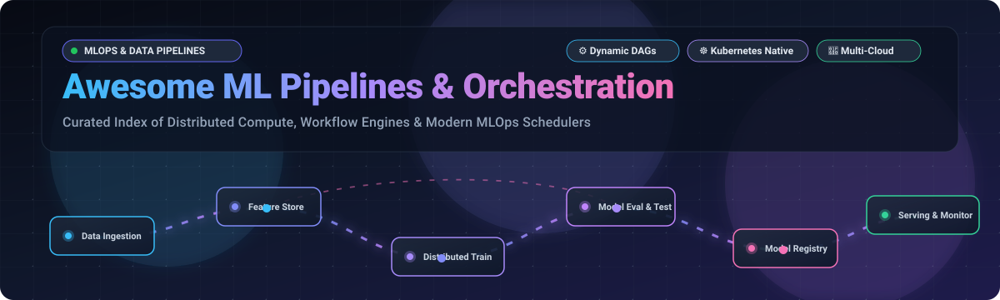
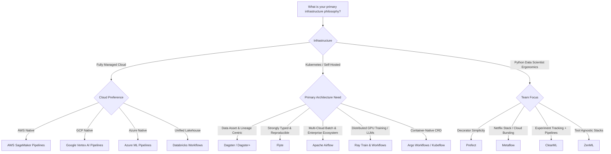

 
 

# 🚀 Awesome ML Pipelines & Orchestration ⚡

**A Curated Index of Modern Machine Learning Pipelines, Distributed Compute Orchestrators, DAG Schedulers, and Enterprise MLOps Platforms**

*Covering Multi-Backend Compute Coordination, Dynamic Workflows, Kubernetes-Native Schedulers & Data Scientist Ergonomics*

---

## 📖 Overview & SEO Keywords

Welcome to **Awesome ML Pipelines & Orchestration** — the definitive guide for ML Platform Engineers, Data Scientists, MLOps Practitioners, and Data Engineers.

Modern Machine Learning systems require coordinating complex Directed Acyclic Graphs (DAGs) across heterogeneous infrastructure: distributed GPU training clusters, feature store ingestion, hyperparameter tuning, model validation, and zero-downtime serving. This repository tracks both industry-leading **SaaS Platforms** and cutting-edge **Open-Source Orchestration Engines** that automate machine learning workflows without stitching together brittle, disconnected bash scripts.

> **Key Topics & Ecosystem Categories**: `MLOps`, `Machine Learning Pipelines`, `Workflow Orchestration`, `DAG Schedulers`, `Distributed Training`, `Kubernetes-Native ML`, `Data Pipelines`, `ETL/ELT Workflows`, `Feature Engineering`, `Model Registry Lineage`, `GenAI/LLM Pipelines`.

---

## 📑 Table of Contents

- [🌐 Sector Overview & Market Dynamics](#-sector-overview--market-dynamics)
- [☁️ SaaS & Hosted Enterprise ML Platforms](#️-saas--hosted-enterprise-ml-platforms)
- [🐙 Open-Source GitHub Projects](#-open-source-github-projects)
- [🧩 Architecture Patterns & Selection Guide](#-architecture-patterns--selection-guide)
- [🤝 How to Contribute](#-how-to-contribute)
- [💖 Support & Sponsoring](#-support--sponsoring)
- [⭐ Star History](#-star-history)
- [⚖️ Disclaimer & License](#️-disclaimer--license)

---

## 🌐 Sector Overview & Market Dynamics

- **Market Size & Exponential Growth**: The global **Machine Learning Operations (MLOps) and Pipeline Orchestration market** was valued at approximately **$2.2 billion in 2024** and is projected to reach **$17.8 billion by 2032**, compounding at an aggressive **CAGR of ~30.5%**. This rapid acceleration is heavily propelled by the enterprise transition from experimental LLM prototypes to production-grade continuous fine-tuning, RAG data ingestion pipelines, and agentic workflows requiring multi-step execution.
- **Market Concentration & Competitive Landscape**: The sector displays **moderate fragmentation with dual gravitational centers**. Hyper-scaler cloud ecosystems (**AWS SageMaker**, **Google Vertex AI**, and **Azure ML**) dominate large enterprises prioritizing integrated security, identity, and compliance. Concurrently, **independent and open-source orchestrators** (**Apache Airflow**, **Ray**, **Kubeflow**, **Flyte**, **Dagster**, and **Prefect**) command substantial developer mindshare, preventing single-vendor monopolization by empowering multi-cloud portability, Kubernetes-native runtime control, and specialized hardware acceleration across heterogeneous compute backends.

---

## ☁️ SaaS & Hosted Enterprise ML Platforms

The following hosted and managed enterprise platforms are sorted in descending order by **Company Size (Market Capitalization or Valuation)**.

| 🏢 Platform & Provider | 📊 Company Size (Valuation / Revenue) | 💵 Starting Tier Pricing | 🎁 Free Tier Limit & Trial Details | 🌟 Key Strengths & Architecture Focus |
| :--- | :--- | :--- | :--- | :--- |
| **[Azure Machine Learning](https://azure.microsoft.com/en-us/products/machine-learning)**  *(Microsoft)* | **$3.12 Trillion** Market Cap  *(FY24 Revenue: $245.1B)* | **$0.043/hour** for `Standard_DS1_v2` instance; compute cluster nodes start at **$0.096/hour** (`Standard_D2s_v3`); $0/mo basic platform management fee | **30-Day Free Trial** with **$200 Azure credit** + **12 months free access** to 55+ services (including 750 hrs/mo B1S VM) and perpetual free Azure ML workspace access | 🛡️ Enterprise governance, deep Microsoft Fabric & Azure DevOps integration, MLflow-native model registry, and built-in Responsible AI dashboards. |
| **[Google Vertex AI Pipelines](https://cloud.google.com/vertex-ai/docs/pipelines/introduction)**  *(Google Cloud / Alphabet)* | **$2.15 Trillion** Market Cap  *(Alphabet FY24: $350.0B; GCP: ~$43B ARR)* | **$0.03 per pipeline run** orchestrator fee + underlying compute starting at **$0.067/hour** (`e2-standard-2`) | **90-Day Free Trial** with **$300 Google Cloud credits** applicable across all Vertex AI APIs and compute backends + always-free 5 GB Cloud Storage | 🌐 KFP v2 OSS portable, native integration with Gemini models, built-in AutoML, Serverless pipeline execution without managing Kubernetes nodes. |
| **[AWS SageMaker Pipelines](https://aws.amazon.com/sagemaker/pipelines/)**  *(Amazon Web Services)* | **$2.05 Trillion** Market Cap  *(Amazon FY24: $620.0B; AWS: ~$105B ARR)* | **$0.05 per pipeline step run** execution fee + underlying compute (processing jobs on `ml.t3.medium` at **$0.05/hour**, training on `ml.m5.large` at **$0.115/hour**) | **2-Month Free Trial** with **50 hours/month** of `ml.t3.medium` Studio notebooks, **50 hours/month** of `ml.m5.large` training, and **125 hours/month** of real-time endpoints | 🏗️ The most cited MLOps platform in enterprise job listings; end-to-end lifecycle tooling from Feature Store and Data Wrangler to Clarify and Bedrock foundation models. |
| **[Databricks Workflows](https://www.databricks.com/product/workflows)**  *(Databricks)* | **$43.0 Billion** Valuation  *(Private; $2.4B+ ARR)* | **$0.07 per DBU** (Databricks Unit) for Classic All-Purpose Jobs or **$0.15/DBU** for Automated Jobs Compute + raw cloud infrastructure | **14-Day Free Trial** with unlimited Databricks platform access and DBUs on customer cloud + **Free Forever Community Edition** (1 micro-cluster: 15 GB RAM, 2 vCPUs) | 🧱 Lakehouse unified data engineering and ML architecture; native Delta Lake dataset versioning, MLflow tracking, and Databricks Asset Bundles (DABs). |
| **[Domino Enterprise AI](https://dominodatalab.com/)**  *(Domino Data Lab)* | **$1.20 Billion** Valuation  *(Private; ~$100M ARR)* | **$600/month** (~$7,200/year billed annually) for Domino Cloud Starter seats, or custom annual enterprise contracts with multi-cluster VPC | **14-Day Free Trial** with pre-configured cloud environments, **$200 compute credits**, and 50 GB storage | 👥 Regulated enterprise collaboration hub; supports heterogeneous IDEs (Jupyter, RStudio, VS Code) with multi-cloud burst compute and governance tracking. |
| **[Prefect Cloud](https://www.prefect.io/cloud)**  *(Prefect)* | **$250 Million** Valuation  *(Private; Acquired Dagster Labs)* | **$39/month** (Pro plan: 1 workspace, 5 user seats, unlimited flow runs, 20,000 monthly task runs included, then $0.0005/task run) | **Free Forever Plan** includes 1 user seat, 1 workspace, 1 concurrent execution, and up to **10,000 free task runs per month** | ⚡ Developer-friendly Python `@flow` and `@task` decorators with hybrid execution architecture (control plane in cloud, data plane on private infra). |
| **[ClearML SaaS](https://clear.ml/pricing)**  *(ClearML / Allegro AI)* | **$120 Million** Valuation  *(Private Series B; ~$15M ARR)* | **$15/user/month** (Pro plan: hosted multi-tenant API server, unlimited experiments, up to 100 concurrent compute worker nodes) | **Free Forever Community Plan** includes 3 users, 100 concurrent compute workers, **100 GB file storage**, and unlimited pipeline tracking | 🧪 All-in-one unified MLOps platform pairing dynamic pipeline scheduling with automatic experiment tracking, hyperparameter tuning, and dataset versioning. |
| **[Dagster+ (Dagster Cloud)](https://dagster.io/pricing)**  *(Dagster Labs / Prefect)* | **$100 Million** Valuation  *(Subsidiary of Prefect)* | **$100/month** (Pro plan: includes 1,000 execution credits/month, unlimited users, branch deployments, and hybrid orchestrator agents) | **30-Day Free Trial** with **$100 execution credits** and full enterprise RBAC + **Free Serverless Tier** with **250 credits/month free forever** | 📊 Asset-centric orchestrator treating datasets and ML models as declarative software assets; industry-leading data lineage and testing ergonomics. |
| **[Valohai](https://valohai.com/pricing/)**  *(Valohai)* | **$35 Million** Valuation  *(Private Series A; ~$5M ARR)* | **$49/user/month** (Developer plan) or **$500/month** (Team self-hosted orchestrator with BYO cloud infrastructure) | **14-Day Free Trial** with full platform capabilities, unlimited executions, and up to **10 concurrent pipeline runs** on connected cloud accounts | 🔄 Zero-commitment reproducibility engine with Git-driven pipeline execution across AWS, GCP, Azure, and on-premises GPU clusters. |

---

## 🐙 Open-Source GitHub Projects

The following open-source frameworks are sorted in descending order by **GitHub Star Count**. Every badge links directly to the respective project's stargazer community.

### 1. [Apache Airflow](https://github.com/apache/airflow) 
- 📌 **License**: Apache-2.0
- 🌟 **Stars**: ~47,200+ | 🍴 **Forks**: ~38,000+
- 📝 **Summary**: The industry veteran and most ubiquitous workflow orchestrator in global enterprise data engineering. Airflow features thousands of provider packages connecting SageMaker, Vertex AI, Databricks, MLflow, Weights & Biases, Hugging Face, and Kubernetes execution backends (`KubernetesPodOperator`). Deferrable operators allow long-running ML training jobs to release worker slots while polling asynchronously.
- 💡 **Best For**: ML platform teams supporting complex enterprise DAGs across multiple multi-cloud compute backends with strict governance, auditability, and SLA requirements.

### 2. [Ray](https://github.com/ray-project/ray) 
- 📌 **License**: Apache-2.0
- 🌟 **Stars**: ~44,100+ | 🍴 **Forks**: ~6,500+
- 📝 **Summary**: A unified open-source framework for scaling AI and Python workloads. Ray features **Ray Train** for distributed multi-node multi-GPU model training (PyTorch, DeepSpeed), **Ray Data** for high-throughput batch inference and preprocessing, **Ray Tune** for distributed hyperparameter optimization, and **Ray Serve** for model deployment.
- 💡 **Best For**: Distributed deep learning, LLM pre-training, fine-tuning, and compute-intensive workflows requiring high-speed shared-memory IPC and auto-scaling GPU clusters.

### 3. [MLflow](https://github.com/mlflow/mlflow) 
- 📌 **License**: Apache-2.0
- 🌟 **Stars**: ~28,500+ | 🍴 **Forks**: ~4,700+
- 📝 **Summary**: An open-source platform to manage the complete ML lifecycle, including experimentation, reproducibility, deployment, and a central model registry. MLflow Recipes (formerly MLflow Pipelines) provide structured, opinionated workflow templates for regression, classification, and GenAI evaluation, ensuring standardized project structure across model teams.
- 💡 **Best For**: Teams needing comprehensive experiment tracking, metric visualization, artifact management, and standardized pipeline recipes.

### 4. [Prefect](https://github.com/PrefectHQ/prefect) 
- 📌 **License**: Apache-2.0
- 🌟 **Stars**: ~24,000+ | 🍴 **Forks**: ~2,500+
- 📝 **Summary**: A developer-friendly orchestration engine designed from the ground up for Python-native code. With decorator-style `@flow` and `@task` semantics, Prefect enables engineers to turn arbitrary Python functions into resilient, observable, dynamic pipelines with retries, caching, parameterization, and concurrency controls without boilerplate DAG definitions.
- 💡 **Best For**: Engineering teams wanting fast setup, elegant native Python syntax, and hybrid orchestration where code executes securely in private infrastructure.

### 5. [Luigi](https://github.com/spotify/luigi) 
- 📌 **License**: Apache-2.0
- 🌟 **Stars**: ~18,800+ | 🍴 **Forks**: ~2,500+
- 📝 **Summary**: Spotify's battle-tested Python package that pioneered dependency-based batch job management. Luigi focuses on pipeline plumbing where tasks define explicit target outputs and upstream dependencies, with built-in support for Hadoop, Spark, and local batch tasks.
- 💡 **Best For**: Stable batch execution pipelines and teams seeking a lightweight, purely Python-based dependency resolution engine.

### 6. [Argo Workflows](https://github.com/argoproj/argo-workflows) 
- 📌 **License**: Apache-2.0
- 🌟 **Stars**: ~17,000+ | 🍴 **Forks**: ~3,500+
- 📝 **Summary**: The CNCF Graduated container-native workflow engine implemented as a Kubernetes CRD (Custom Resource Definition). Each step in an Argo Workflow executes as an isolated Kubernetes pod, allowing native resource quotas, GPU affinity, sidecars, and artifact passing via S3/GCS. Underpins Kubeflow Pipelines' execution backend.
- 💡 **Best For**: Kubernetes-first infrastructure teams desiring direct YAML/GitOps pipeline definitions without language-specific abstractions.

### 7. [Dagster](https://github.com/dagster-io/dagster) 
- 📌 **License**: Apache-2.0
- 🌟 **Stars**: ~16,300+ | 🍴 **Forks**: ~2,100+
- 📝 **Summary**: The asset-based orchestrator designed specifically for modern data and ML assets. Rather than merely ordering task execution, Dagster models the data assets (tables, feature sets, models) produced and consumed, delivering unmatched data observability, lineage visualization, and comprehensive unit-testing ergonomics.
- 💡 **Best For**: Asset-centric workflows, RAG embedding pipelines, feature engineering, and organizations bridging data engineering with production ML modeling.

### 8. [Kedro](https://github.com/kedro-org/kedro) 
- 📌 **License**: Apache-2.0
- 🌟 **Stars**: ~11,000+ | 🍴 **Forks**: ~1,100+
- 📝 **Summary**: An open-source Python framework developed by QuantumBlack/McKinsey that applies software engineering best practices to data science code. Kedro enforces clean separation between data extraction, transformation, feature generation, and modeling through modular DataCatalog abstraction and pure functional nodes.
- 💡 **Best For**: Data science consulting teams and enterprise analytics groups transitioning messy Jupyter notebooks into clean, production-grade pipelines.

### 9. [Metaflow](https://github.com/Netflix/metaflow) 
- 📌 **License**: Apache-2.0
- 🌟 **Stars**: ~10,300+ | 🍴 **Forks**: ~1,000+
- 📝 **Summary**: Developed at Netflix to accelerate data science velocity across classical statistical modeling and deep learning. Metaflow emphasizes human-centric ergonomics: workflows are written in standard Python, while Metaflow seamlessly provisions cloud compute (AWS Batch, Kubernetes, Titus), snapshots artifact state at every `@step`, and supports interactive debugging.
- 💡 **Best For**: Data scientists who want to focus on machine learning algorithms without wrestling with Dockerfiles, Kubernetes manifests, or infrastructure plumbing.

### 10. [Flyte](https://github.com/flyteorg/flyte) 
- 📌 **License**: Apache-2.0
- 🌟 **Stars**: ~7,750+ | 🍴 **Forks**: ~1,100+
- 📝 **Summary**: A strongly typed, Kubernetes-native orchestrator built at Lyft for mission-critical, reproducible pipelines. Flyte validates data types at compile time, ensures immutable execution history, features map-tasks for dynamic parallelism, and incorporates self-healing capabilities that automatically recover from infrastructure-level OOM and preemptible GPU spot evictions.
- 💡 **Best For**: Large ML platform teams supporting heterogeneous model pipelines with strict type safety, dynamic branching, and multi-tenant Kubernetes clusters.

### 11. [ClearML](https://github.com/allegroai/clearml) 
- 📌 **License**: Apache-2.0
- 🌟 **Stars**: ~6,900+ | 🍴 **Forks**: ~800+
- 📝 **Summary**: An open-source CI/CD and MLOps suite that bundles task orchestration, experiment tracking, model repository, and remote execution agent management. Integrating just 2 lines of Python automatically logs git commits, uncommitted diffs, environment parameters, seeds, and hardware telemetry.
- 💡 **Best For**: Research and development teams seeking an all-in-one open-source alternative to fragmented point solutions.

### 12. [Pachyderm](https://github.com/pachyderm/pachyderm) 
- 📌 **License**: Apache-2.0
- 🌟 **Stars**: ~6,300+ | 🍴 **Forks**: ~700+
- 📝 **Summary**: A data-driven pipeline platform built on Kubernetes that pairs Git-like data versioning (PFS) with automated, containerized pipeline execution (PPS). Pipelines trigger incrementally when new data commits arrive, executing only on the delta change to minimize compute overhead.
- 💡 **Best For**: Workflows with strict data audit trails, compliance verification, and data-driven incremental computation requirements.

### 13. [ZenML](https://github.com/zenml-io/zenml) 
- 📌 **License**: Apache-2.0
- 🌟 **Stars**: ~5,600+ | 🍴 **Forks**: ~650+
- 📝 **Summary**: An extensible, vendor-agnostic MLOps orchestration framework. ZenML separates pipeline code from infrastructure definitions, enabling data scientists to write pipelines once locally and switch execution orchestrators (Kubeflow, Airflow, Vertex AI, SageMaker, Skypilot) via interchangeable stack recipes.
- 💡 **Best For**: Teams wanting infrastructure abstraction without rewriting pipeline code when migrating between cloud providers and local testing.

### 14. [Kubeflow Pipelines (KFP)](https://github.com/kubeflow/pipelines) 
- 📌 **License**: Apache-2.0
- 🌟 **Stars**: ~4,250+ *(Kubeflow ecosystem: 15,000+)* | 🍴 **Forks**: ~1,800+
- 📝 **Summary**: The Kubernetes-native ML pipeline engine based on Docker containers and DSL-decorated Python functions. KFP manages pipeline components as container specifications, providing an end-to-end UI, metadata store (MLMD), and native interoperability with Google Cloud Vertex AI Pipelines through KFP v2 specs.
- 💡 **Best For**: Organizations standardized on Kubernetes clusters with strong in-house DevOps support and hybrid migration paths to Google Cloud.

### 15. [Nextflow](https://github.com/nextflow-io/nextflow) 
- 📌 **License**: Apache-2.0
- 🌟 **Stars**: ~3,500+ | 🍴 **Forks**: ~800+
- 📝 **Summary**: A reactive workflow framework enabling scalable and reproducible scientific and genomic pipelines across HPC clusters (SLURM, PBS, LSF), AWS Batch, and Kubernetes using Docker/Singularity containers.
- 💡 **Best For**: Scientific computing, computational biology, and large-scale data-intensive batch transformation pipelines.

### 16. [Snakemake](https://github.com/snakemake/snakemake) 
- 📌 **License**: MIT
- 🌟 **Stars**: ~2,900+ | 🍴 **Forks**: ~650+
- 📝 **Summary**: A workflow management system based on Python and GNU Make syntax that facilitates reproducible and scalable data analysis. Workflows are defined via human-readable rules that automatically infer dependencies based on input and output file patterns.
- 💡 **Best For**: Research labs, bioinformaticians, and file-centric batch processing workflows requiring seamless execution from local workstations to high-performance computing clusters.

### 17. [TFX (TensorFlow Extended)](https://github.com/tensorflow/tfx) 
- 📌 **License**: Apache-2.0
- 🌟 **Stars**: ~2,200+ | 🍴 **Forks**: ~500+
- 📝 **Summary**: Google's production-grade machine learning platform framework. TFX standardizes data validation (`ExampleGen`, `SchemaGen`), model evaluation (`Evaluator`), and serving packaging (`Pusher`) across multiple orchestrators including Apache Beam, Apache Airflow, and Kubeflow Pipelines.
- 💡 **Best For**: Large-scale TensorFlow deployments requiring battle-tested components for data drift detection and model schema validation.

---

## 🧩 Architecture Patterns & Selection Guide

When designing your ML pipeline architecture, select tools that harmonize with your team's DevOps maturity and cloud footprint:

---

## 🤝 How to Contribute

We love contributions! Follow these steps to submit additions or updates:

1. 🍴 **Fork the repository** on GitHub.
2. 🌿 **Create a feature branch** (`git checkout -b feature/add-new-orchestrator`).
3. 📝 **Add or update entries** in `README.md`:
   - Follow the established formatting (emojis, badges, pricing specifics, and stargazers links).
   - Ensure SaaS entries have exact starting tier pricing and specific free trial terms.
   - Ensure open-source entries include the shields.io social star badge linking to the `/stargazers` page.
4. 📬 **Submit a Pull Request** with a concise description of the tool and why it belongs in this index.

Please ensure all linked projects are active and descriptions remain objective and factual.

---

## 💖 Support & Sponsoring

A huge thank you to everyone across the open-source and MLOps community who uses, stars, and contributes to this repository! 🌟

If you find this curated collection useful for your MLOps architecture, machine learning workflows, or research:
- ⭐ **Star this repository** to help others discover it!
- 🍴 **Fork and share** with colleagues, ML platform teams, and developer communities.
- ☕ **Buy Me a Coffee / Sponsor**: If you would like to support ongoing curation and maintenance of this list and related open-source projects, consider sponsoring via the **[GitHub Sponsors Dashboard](https://github.com/sponsors/ishandutta2007)**.

---

### ⭐ Star History

---

## ⚖️ Disclaimer & License

- **Disclaimer**: This is a community-curated directory intended for educational and architectural decision-making purposes. All product names, logos, and trademarks belong to their respective owners.
- **License**: Released under the [MIT License](LICENSE). Curated with ❤️ by [Ishan Dutta](https://github.com/ishandutta2007) and the open-source community.
